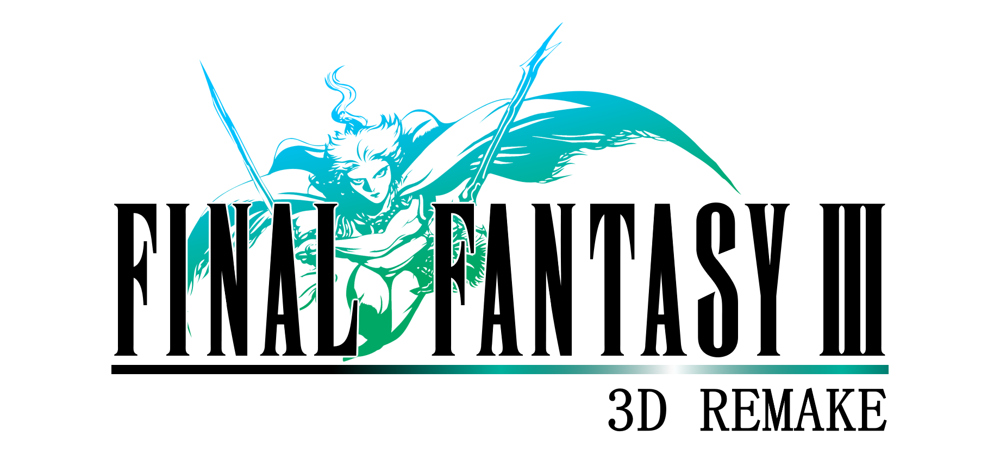

<h1 align=center>Final Fantasy III 3D — Nintendo Switch port</h1>

This is a wrapper/port of the Android version of *Final Fantasy III 3D*
(`com.square_enix.android_googleplay.FFIII_GP`, v2.0.6). It loads the original
Android `libff3.so`, resolves its Android imports, and runs it inside a minimal
emulated Android environment on Nintendo Switch.

### How to install

Create `/switch/ff3_3d/` on your SD card and copy at the root:

* `ff3_3d_nx.nro`
* `lib/arm64-v8a/libff3.so` from the Android APK as `libff3.so`
* `assets/main.obb` from the Android APK as `main.obb`
* `res/raw/opening.mp4` as `opening.mp4`

This will not work in applet/album mode. Use a game override or a forwarder.

Saves, config and logs are stored in `/switch/ff3_3d/`.

### Controls

A confirms and B cancels. X opens the menu and Y interacts with temporary party
members, matching the Nintendo DS layout. Plus also opens the menu; R and Minus
open the map.

### Configuration

`config.txt` is created on first run:

* `screen_width` / `screen_height` — render resolution; `-1` selects 1280x720 handheld and 1920x1080 docked.
* `widescreen` — defaults to `1`.
* `language` - language index: `0` ja, `1` en, `2` fr, `3` de, `4` it, `5` es, `6` zh_CN, `7` zh_TW, `8` ko, `9` th. Defaults to `1` (English).

### How to build

You need devkitA64 and these devkitPro packages:

* `switch-mesa`
* `switch-libdrm_nouveau`
* `switch-sdl2`
* `switch-freetype`
* `switch-libpng`
* `switch-harfbuzz`
* `switch-ffmpeg`
* `switch-dav1d`

### Credits

* fgsfds for [max_nx](https://github.com/fgsfdsfgs/max_nx), which this loader is based on
* TheOfficialFloW for the original Vita ports

### Support

If you enjoy my work and want to support me :

### Legal

This project has no direct affiliation with Square Enix. "Final Fantasy" and "Final
Fantasy III" are trademarks of their respective owners. All Rights Reserved.

No assets or program code from the original game or its Android port are included in this
project. We do not condone piracy in any way, shape or form and encourage users to
legally own the original game.